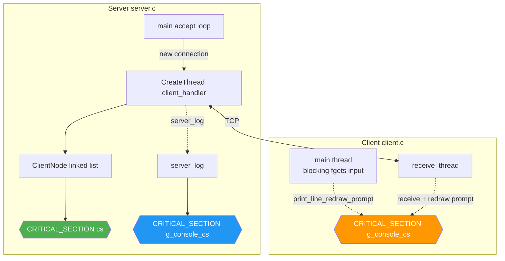
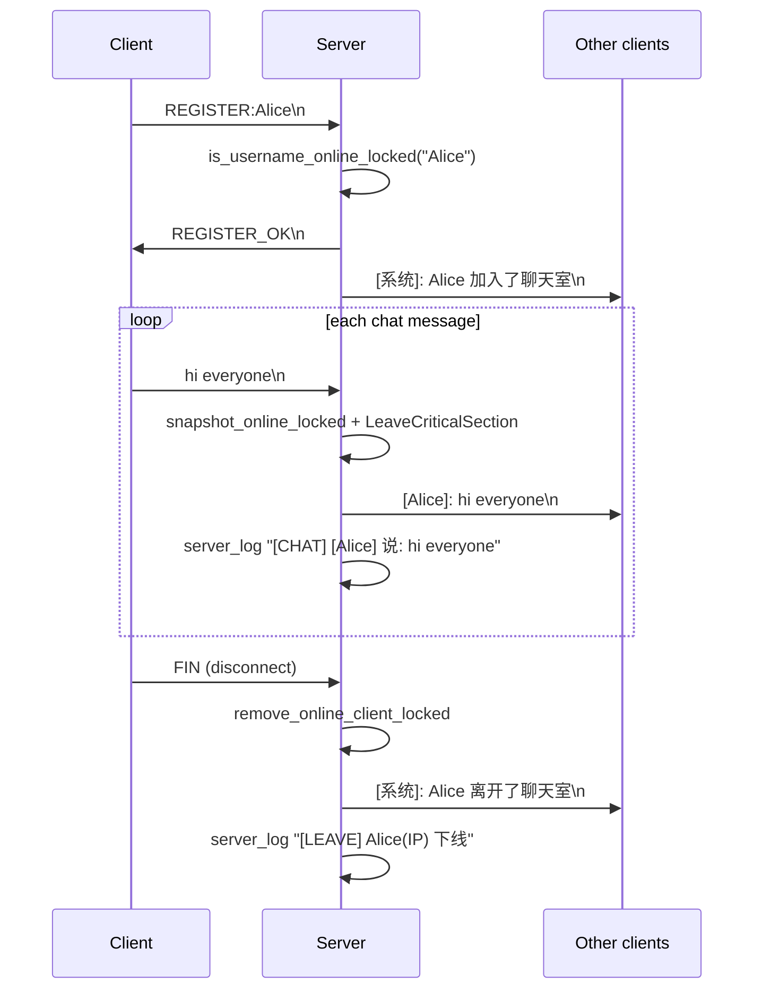
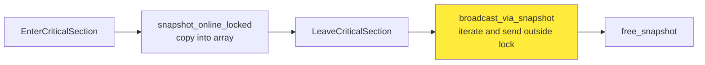

English version:

# Simple Chat Room

[](https://en.wikipedia.org/wiki/C_(programming_language))
[](https://gcc.gnu.org/)
[](https://www.microsoft.com/windows)
[](https://learn.microsoft.com/windows/win32/winsock/winsock-functions)

A simple TCP chat room built on WinSock2. The server handles concurrent clients with one thread per connection. The client uses two threads: one for async receive, one for blocking input.

---

## Features

| Feature | Description |
|------|------|
| Multi-client concurrency | Server creates one thread per connection, max 100 clients |
| Online registration | Username uniqueness is checked; the name is released when the user disconnects |
| Real-time broadcast | Chat messages and join/leave notices are broadcast to all online users |
| Dynamic prompt | Client prompt switches between `[username]>` and `(unregistered)>` based on registration state |
| Thread safety | Linked-list operations and console output are protected by critical sections; broadcasts are sent outside the lock so slow clients don't block everyone |
| Full logging | Server keeps a timestamped chat log: connect/register/chat/leave |
| Graceful shutdown | Ctrl+C on the server closes all connections and frees resources; `/quit` exits the client cleanly |
| Configurable IP | Client accepts the server IP as a command-line argument; defaults to `127.0.0.1` |

---

## Architecture

### Thread model



### Message flow (register → chat)



---

## Dependencies

| Dependency | Notes |
|------|------|
| GCC / MinGW-w64 | Recommended. This project compiles with `-O2 -Wall -Wextra` |
| MSVC (optional) | `#ifdef _MSC_VER` already includes `#pragma comment(lib, ...)`, so no extra link flags are needed |
| `ws2_32.lib` | WinSock 2.2, core networking library |
| `wsock32.lib` | WinSock 1.x compatibility layer, provides `inet_ntoa` and similar functions |

> This project is **Windows-only** (it uses `winsock2.h` and Win32 thread APIs). To port it to Linux, replace `winsock2.h` with `sys/socket.h`, `CreateThread` with `pthread_create`, and `CRITICAL_SECTION` with `pthread_mutex_t`.

---

## Build

### Windows + MinGW

```bash
gcc -O2 -Wall -Wextra server.c -o server.exe -lws2_32 -lwsock32
gcc -O2 -Wall -Wextra client.c -o client.exe -lws2_32 -lwsock32
```

### Windows + MSVC

```cmd
cl /O2 /W3 server.c user32.lib ws2_32.lib wsock32.lib
cl /O2 /W3 client.c user32.lib ws2_32.lib wsock32.lib
```

This produces `server.exe` and `client.exe`.

---

## Run

### Start the server

```bash
./server.exe
```

Listens on `0.0.0.0:8888` by default. Press `Ctrl+C` to exit.

### Start a client

```bash
./client.exe                # connects to 127.0.0.1:8888 by default
./client.exe 192.168.10.12  # connect to a specific IP
```

### Commands

| Input | Action |
|------|------|
| `REGISTER:your_username` | Register and log in (username: 1–31 characters) |
| `/quit` or `/exit` | Exit the client |
| Anything else | Sent as a chat message (the server rejects it if you are not registered) |

---

## Protocol

All messages are plain text ending with `\n` (LF). There is no extra serialization.

### Client → server

| Prefix | Format | Description |
|------|------|------|
| `REGISTER:` | `REGISTER:<username>\n` | Register and log in |
| Other | `<any content>\n` | Chat message (ignored if not registered) |

### Server → client

| Prefix | Format | Description |
|------|------|------|
| `REGISTER_OK` | `REGISTER_OK\n` | Registration succeeded |
| `REGISTER_FAIL:` | `REGISTER_FAIL:<reason>\n` | Registration failed |
| `[系统]` | `[系统]: ...\n` | System notice (join/leave) |
| `[username]` | `[username]: <message>\n` | Chat broadcast |

---

## Screenshots

### Server log (timestamped)


### Client 1 (Anjuxi)


### Client 2 (Ailan)


---

## Project Structure

```
.
├── server.c                # server source (~400 lines)
├── client.c                # client source (~195 lines)
├── server.exe              # build output
├── client.exe              # build output
├── 服务端运行情况.png       # screenshot
├── 客户端1运行情况.png      # screenshot
├── 客户端2运行情况.png      # screenshot
└── README.md
```

---

## Implementation Notes

### Broadcast outside the lock (avoid slow clients blocking)



While holding the lock, the linked list is only used to take a snapshot: socket handles are copied into a separate array. The actual `send()` calls run outside the lock. This way, a slow or disconnected client won't block other threads, and the `accept` thread won't be starved.

### Client console: lock-free input, locked output

`fgets()` blocks. If it ran inside the lock, the receive thread would not be able to write to the console. The approach is:

- **Input**: the main thread calls `fgets` outside the lock; only after input does it take the lock to redraw the prompt.
- **Output**: when the receive thread gets a message, it takes the lock and atomically does three things: clear the current line, print the message, redraw the prompt.

Both threads share `g_console_cs`, so the prompt stays visible.

### Username uniqueness = check the online list

Only one linked list, `online_clients`, is maintained. There is no separate "registered usernames" table. Registration walks the list to check for duplicates; removing a client from the list on disconnect releases the name. This avoids permanently reserving a name after one registration and saves an extra table.

---

## Author

**Ailan Anjuxi (谙弆悕博士)**

Email: <anjuxi.ME@outlook.com>

SIP: [sip:anjuxi@sip.linphone.org](sip:anjuxi@sip.linphone.org)

---

*This project uses C and the Win32 API. It is intended for learning TCP network programming and multithreaded synchronization.*
