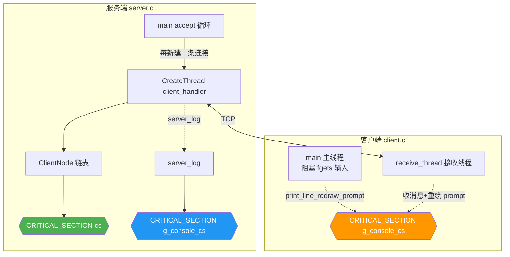
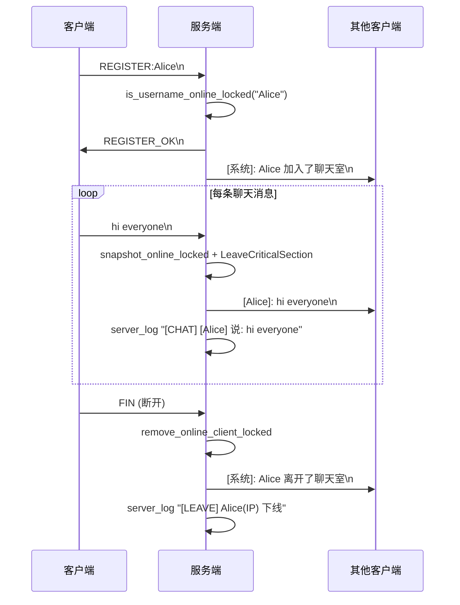
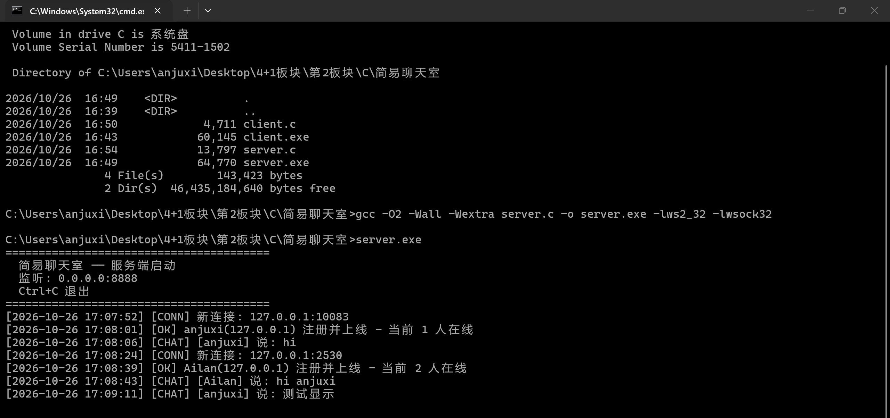
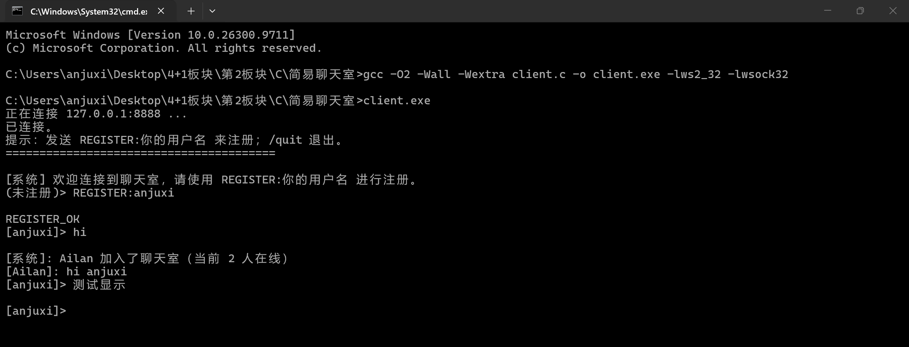
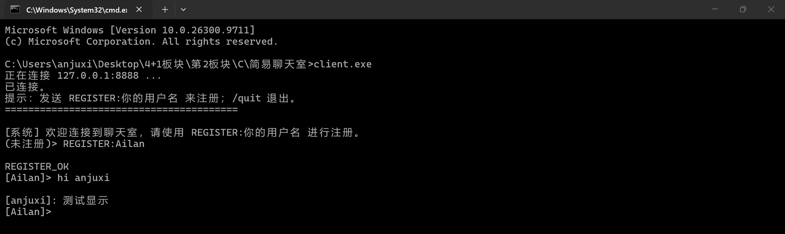
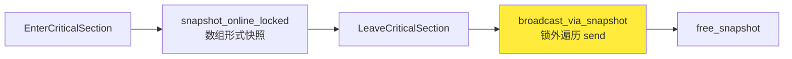

# 简易聊天室

[](https://en.wikipedia.org/wiki/C_(programming_language))
[](https://gcc.gnu.org/)
[](https://www.microsoft.com/windows)
[](https://learn.microsoft.com/windows/win32/winsock/winsock-functions)

基于 WinSock2 的 TCP 简易聊天室，服务端多线程并发处理，客户端异步接收 + 阻塞输入双线程配合。

---

## ✨ 功能特性

| 特性 | 说明 |
|------|------|
| 🧑‍🤝‍🧑 多客户端并发 | 服务端每连接一个新线程，上限 100 人 |
| 🔐 在线注册 | 用户名唯一校验，下线后名字自动释放 |
| 📢 实时广播 | 聊天消息、加入/离开通知实时广播给所有在线用户 |
| 🎨 动态 Prompt | 客户端 prompt 根据注册状态自动切换 `[用户名]>` / `(未注册)>` |
| 🔒 线程安全 | 链表操作、控制台输出均有临界区保护；广播在锁外发送，慢客户端不阻塞整体 |
| 📝 全量日志 | 服务端带时间戳的完整聊天记录：连接/注册/聊天/离开 |
| 🛑 优雅退出 | 服务端 Ctrl+C 自动关闭所有连接、释放资源；客户端 `/quit` 干净退出 |
| 📱 可配置 IP | 客户端支持命令行参数指定服务端 IP，默认 `127.0.0.1` |

---

## 🏗️ 架构

### 线程模型



### 通信流程（注册 → 聊天）



---

## 🧩 依赖

| 依赖 | 说明 |
|------|------|
| GCC / MinGW-w64 | 推荐，本项目用 `-O2 -Wall -Wextra` 编译通过 |
| MSVC (可选) | `#ifdef _MSC_VER` 已包含 `#pragma comment(lib, ...)`，无需额外命令行链接 |
| `ws2_32.lib` | WinSock 2.2，网络编程核心库 |
| `wsock32.lib` | WinSock 1.x 兼容层，提供 `inet_ntoa` 等函数 |

> 本项目**只有 Windows** 能跑（用了 `winsock2.h` 和 Win32 线程 API）。如果要移植到 Linux，把 `winsock2.h` 换成 `sys/socket.h`、把 `CreateThread` 换成 `pthread_create`、把 `CRITICAL_SECTION` 换成 `pthread_mutex_t` 即可。

---

## 🛠️ 构建

### Windows + MinGW

```bash
gcc -O2 -Wall -Wextra server.c -o server.exe -lws2_32 -lwsock32
gcc -O2 -Wall -Wextra client.c -o client.exe -lws2_32 -lwsock32
```

### Windows + MSVC

```cmd
cl /O2 /W3 server.c user32.lib ws2_32.lib wsock32.lib
cl /O2 /W3 client.c user32.lib ws2_32.lib wsock32.lib
```

编译完成后会生成 `server.exe` 和 `client.exe`。

---

## ▶️ 运行

### 启动服务端

```bash
./server.exe
```

默认监听 `0.0.0.0:8888`。`Ctrl+C` 退出。

### 启动客户端

```bash
./client.exe                # 默认连接 127.0.0.1:8888
./client.exe 192.168.10.12   # 连接指定 IP
```

### 交互命令

| 输入 | 作用 |
|------|------|
| `REGISTER:你的用户名` | 注册并登录（用户名 1~31 字符） |
| `/quit` 或 `/exit` | 退出客户端 |
| 其他任意内容 | 发送为聊天消息（未注册时服务端会拒绝） |

---

## 📡 通信协议

所有消息均为 `\n`（LF）结尾的纯文本，无额外序列化。

### 客户端 → 服务端

| 前缀 | 格式 | 说明 |
|------|------|------|
| `REGISTER:` | `REGISTER:<用户名>\n` | 注册并登录 |
| 其他 | `<任意内容>\n` | 聊天消息（未注册时被忽略） |

### 服务端 → 客户端

| 前缀 | 格式 | 说明 |
|------|------|------|
| `REGISTER_OK` | `REGISTER_OK\n` | 注册成功 |
| `REGISTER_FAIL:` | `REGISTER_FAIL:<原因>\n` | 注册失败 |
| `[系统]` | `[系统]: ...\n` | 系统通知（加入、离开） |
| `[用户名]` | `[用户名]: <消息>\n` | 聊天广播 |

---

## 📸 运行截图

### 服务端日志（带时间戳）



### 客户端 1（Anjuxi）



### 客户端 2（Ailan）



---

## 📁 项目结构

```
.
├── server.c                # 服务端源码（400 行）
├── client.c                # 客户端源码（195 行）
├── server.exe              # 编译产物
├── client.exe              # 编译产物
├── 服务端运行情况.png       # 文档配图
├── 客户端1运行情况.png      # 文档配图
├── 客户端2运行情况.png      # 文档配图
└── README.md
```

---

## 🔧 核心实现要点

### 锁外广播（避免慢客户端阻塞）



链表在持锁期间只做"快照"（把 sock 拷贝到一个独立数组），真正的 `send()` 在锁外遍历快照执行。这样某个客户端网络很慢或断开都不会卡住其他线程，也不会让 `accept` 线程被饿死。

### 客户端控制台无锁输入 + 加锁输出

`fgets()` 是阻塞的，如果放进锁里会导致接收线程也打不了控制台。所以策略是：

- **输入**：主线程在锁外 `fgets`，输入完才抢锁重绘 prompt
- **输出**：接收线程收到消息后，抢锁原子执行"清当前行 → 打消息 → 重绘 prompt"三步

两个线程通过同一把 `g_console_cs` 协调，prompt 永远可见。

### 用户名唯一性 = 在线链表查重

只维护一张在线链表 `online_clients`，**不**额外维护"已注册用户名表"。注册时直接遍历链表查重，下线时从链表移除即视为名字释放。这样不会出现"注册一次永久占用"的问题，也省了一张注册表。

---

## 👤 作者

**谙弆悕博士（Ailan Anjuxi）**

📧 邮箱：<anjuxi.ME@outlook.com>

📞 SIP 电话：[sip:anjuxi@sip.linphone.org](sip:anjuxi@sip.linphone.org)

---

*本项目基于 C 语言和 Win32 API，仅用于学习 TCP 网络编程与多线程同步。*
